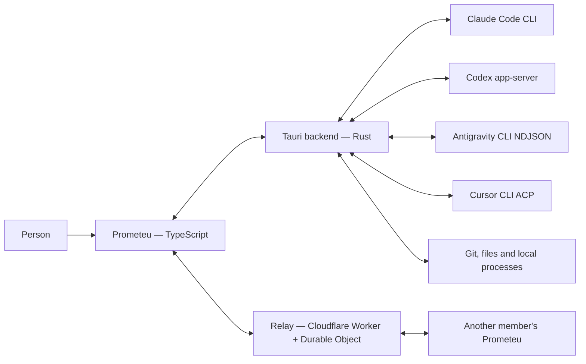

# Prometeu architecture

This document is the map of the current system. The protocols are in
`docs/contracts/`. Accepted ADRs give the decisions that continue to apply.
Proposals show their status in the proposal. Git history keeps the replaced
decisions.

## System goal

Prometeu is a desktop app that organizes agent sessions for each workspace. Each
workspace can have these items:

- an isolated worktree
- many conversation tabs
- terminals for the work
- live shared sessions with a team

The app does not contain a model. It runs the CLIs that the person installed on
the machine. It translates their protocols and shows the work as a usual
conversation.

## Context



The agent process and the workspace files have the permissions of the local
user. The worktree isolates the changes in Git, but it is not a sandbox. Shared
content uses E2EE v4. The relay gets the ciphertext and the routing metadata. The
server directory accepts the first identity (TOFU). See
[the limits](docs/decisions/0022-end-to-end-encryption.md).

Remote messages and remote control operate only for the persons that the owner
gave these rights to in that workspace. They also operate only from pairs of
member and key that the owner approved on the Mac of the owner. To view and to
comment, these rights are not necessary. By default, a message from a teammate
also waits in memory until the owner sends it
([ADR 0090](docs/decisions/0090-approved-remote-input.md)). Prometeu does not
write this message to the disk.

## Containers and responsibilities

| Container | Technology | Responsibility | Must not own |
| --- | --- | --- | --- |
| Frontend | TypeScript + Vite | the interaction, the presentation, the timeline and the temporary UI state | the lifecycle of processes and the rules of the file system |
| Backend | Rust + Tauri | the stored state, processes, Git, files, IPC and the translation of agent protocols | the visual rules and the translation of interface text |
| Claude adapter | `claude.rs` | change V1 commands to stream-json, and stream-json to V1 events | the DOM, the board state or the relay |
| Antigravity adapter | `antigravity.rs` | change native NDJSON to V1, and resume the native history | the DOM, the board state or the relay |
| Codex adapter | `crates/protocols/src/codex.rs`, desktop `codex.rs` composition | change V1 commands to JSON-RPC, and JSON-RPC to V1 events | the DOM, the board state or the relay |
| Cursor adapter | `crates/protocols/src/cursor.rs`, desktop `cursor.rs` composition | change ACP to V1, and keep the identity of the native session | the DOM, the board state or the relay |
| Relay | Worker + Durable Object | enrollment, the online status of members, the audience, comments and the transmission of messages | agent execution or access to the worktree |
| Web mock | `src/mock.ts` | answer the same IPC for UI development and for E2E | a replacement for the tests of the Rust backend |
| Prometeu Cloud (a different project) | Rails 8.1 + SQLite + ERB | the optional account, organizations, invitations, tool catalogs and the delivery of supervision webhooks | agent execution, general files, provider credentials or transcripts |

## Current primary flow

The conversation uses a contract that Prometeu owns:

```text
Claude stream-json ─> claude.rs ───────────┐
                                           ├─> ConversationEventV1 ─> Pump/relay ─> timeline.ts ─> chat.ts
Codex JSON-RPC ─> protocols::codex ────────────────┤
Antigravity ────> antigravity.rs ───────────────┤
Cursor ACP ────> protocols::cursor ────────────┘
```

`prometeu-core` keeps the V1 lines and gives a number to each line. It also
controls these items:

- input
- the movement of a conversation to a different account
- reactions
- launch
- workers

The core also owns the shutdown policy. The caller gives the effects to it.

`chat.rs` and `chat/host.rs` compose those services with `prometeu-process` and
the provider adapters. The process crate starts processes, reads the pipes to
the end and collects the stopped processes. `agent_launch.rs` connects the
provider adapters to the launch. `prometeu-tools` prepares MCP, plugins and skills each time
that a process starts. See the
[application-core contract](docs/contracts/application-core.md) and
[ADR 0085](docs/decisions/0085-portable-core.md).

`timeline.ts` validates those lines and changes them into items that do not
use the DOM. `chat.ts` renders the items and sends `ConversationCommandV1`. An
adapter changes older transcripts before the reducer, and it does not write the
transcripts again.

The canonical protocol is the decision that ADR 0002 accepted. The code also
contains the typed catalog and the capabilities from ADR 0003.

See [`docs/architecture/conversation-flow.md`](docs/architecture/conversation-flow.md).

## Remote machines

A workspace can operate on a different computer through SSH. `prometeu-host`
(`src-tauri/crates/host/`) is a static Linux daemon. The desktop installs it.
The host does these tasks:

- It owns the terminal agents in PTYs.
- It keeps their hooks for desktops that are not connected.
- It streams their transcript files.
- It applies systemd limits to each workspace.

Many computers can stay attached at the same time, with one attachment for each
device ([ADR 0104](docs/decisions/0104-several-computers-on-one-machine.md)).
The desktop (`src-tauri/src/remote/`) keeps the board, the conversations, the
journal and the interface.

The desktop connects to the host through the `ssh` of the system. It connects
again after sleep or after the computer starts again. Then it attaches again from the last
output sequence. External clients use the local stdio MCP of the host, which
authenticates them. The integrator is responsible for the deployment and the
infrastructure of the client.

Claude and Codex run on the remote machine. The engine of a Codex conversation
also runs on the machine. The desktop reads its RPC through a relay terminal
([ADR 0105](docs/decisions/0105-codex-on-remote-machines.md)). See
[ADR 0101](docs/decisions/0101-remote-machines.md) and the
[remote host protocol](docs/contracts/remote-host.md).

A remote workspace can use an external supervisor if the person selects it. The
shared core owns the metadata events and the rules that monitor execution. The
host keeps an outbox and publishes it to the Cloud. The Cloud also sends GitHub
changes and generic signed webhooks. The supervisor reads data and does
operations through the current host MCP.

The remote MCP onboarding prepares the host through the current account and SSH
connection. It also tests the delivery from the host to the receiver. The local
selection of a supervisor and an MCP transport in the opposite direction are
for a subsequent change.
See the [supervision contract](docs/contracts/supervision.md) and
[ADR 0106](docs/decisions/0106-workspace-supervision.md).

## Shared interface

The shared interface comes from `packages/design-system`. This package contains
DOM components that other projects can use, behavior, styles, TypeScript types and a
Rails adapter. `src/ui.ts` and `src/menu.ts` export the package again.
`src/ui-tokens.css` keeps the geometry of the desktop. The Cloud uses the
FormBuilder, the helpers and the runtime from the same package. The
[Design System](docs/architecture/design-system.md) gives the adoption, the
gallery and the dependency rules.

Settings / Resources also shows a view of data and callbacks in
`src/components/resource-view.ts`. The desktop and its isolated gallery share
this view. Resources and Actions compose headers, rows, toolbars, menus and
feedback from `src/components/compositions.ts`. These parts are for use in many
screens. Chat and Git also use components in `src/components/`. The manifest of
this folder connects the APIs, the stories and the code that calls them. The gallery
shows these same components in states that have an address.

Chat keeps the transport and the drafts. Git keeps the operations and the
storage of reviews. The diff reader owns the caches and the observation of the
viewport for each instance. The Hub operations stay with their current owners.
See the [presentation contract](docs/contracts/desktop-presentation.md).

## Optional account

`src-tauri/src/linear.rs` owns the optional Linear connection. It finds issues
in the teams of the user, with an assignee or without an assignee. After an
explicit action of the person, it makes the person the assignee of the issue
that the person selected.
`src/issues.ts` owns the Tasks screen. See the
[Linear issue contract](docs/contracts/linear-issues.md).

The same Tasks destination has a GitHub tab that `src/github-issues.ts` owns.
`src-tauri/src/github_auth.rs` keeps the GitHub App credential from the device
flow. `github_issues.rs` does these tasks:

- It lists the issues that have the user as assignee, the available issues,
  the PRs of the user and the reviews that other persons requested.
- It claims issues.
- It prepares isolated PR branches.

The current launcher owns the creation of workspaces. `github.rs` reads the PR
state of a workspace. See the
[GitHub issue contract](docs/contracts/github-issues.md).

The third tab of Tasks, To-dos (`src/todos.ts`), shows one standalone to-do
list. It does not need an account. `prometeu-core::todos` owns the model and the
store. The list is on this computer or on one remote machine that the person
selects. The embedded MCP and the host MCP use the same list. See the
[to-do contract](docs/contracts/todos.md) and
[ADR 0108](docs/decisions/0108-standalone-todo-list.md).

The Notifications destination (`src/notification-center.ts`) merges the relay
messages that name the user with GitHub activity. The Cloud gets this activity from GitHub App
webhooks. `github_notifications.rs` reads that list of metadata with the Bearer
token of the account. When the person opens an item, it gets the titles and the
comment text from GitHub. See the
[GitHub notifications contract](docs/contracts/github-notifications.md) and
[ADR 0088](docs/decisions/0088-github-app.md).

The optional account is at the top of the sidebar. The `cloud.rs` backend
connects the Mac through the browser and stores the credential privately. The
`prometeu-cloud` project is a different project. It gives these functions:

- account management
- organizations
- invitations by email
- catalogs

The desktop merges shared definitions with private items. See the
[catalog contract](docs/contracts/cloud-catalog.md). Publication is a different step
in operations. See the [contract](docs/contracts/cloud-account.md) and
[ADR 0015](docs/decisions/0015-cloud-rails.md).

## Optional context evaluation

`evaluation.rs` contains a port that the application owns. The port puts text
into one class. It uses a closed question with a small set of answers.
`typesafe.rs` is its only adapter. It keeps the API key of the person in a
private file. No feature uses the port since the removal of the request review
in the launcher. Settings only saves the key and tests it with a synthetic request that
does not change. The port does not use the agent provider, the Cloud account, the
timeline or the relay. See the
[contract](docs/contracts/context-evaluation.md) and
[ADR 0058](docs/decisions/0058-optional-context-evaluation.md).

## Local delegation

The built-in `prometeu` MCP is available, but it is not active by default.
`embedded_mcp.rs` connects stdio to the open desktop through a private Unix
socket. `mcp_access.rs` authenticates clients and limits them to their projects.
`delegation.rs` authorizes only the agents that the same client made. Internal
conversations and external local MCP hosts use the same tools.

The conversation context is optional. External clients that the person
connected stay available after the desktop starts again. Each delegation starts with its own
workspace and conversation. The execution IDs are different. The sidebar shows
internal delegations as one level of sub-workspaces. Each delegation reserves
its initial conversation
([ADR 0099](docs/decisions/0099-sub-workspaces.md)). See the [contract](docs/contracts/embedded-mcp.md)
and [ADR 0049](docs/decisions/0049-embedded-delegation-mcp.md).

## Reusable actions

`actions.rs` keeps the commands, the profiles and the runs on top of current
sessions. `actions.ts` finds the entries for the chat and the menu.
`action-settings.ts` edits the registry. An action is complete when its
conversation turn is complete. Actions do not monitor a PR automatically. They do
not resume the session when GitHub changes occur. See the
[contract](docs/contracts/actions.md) and
[ADR 0009](docs/decisions/0009-reusable-actions.md).

## State and persistence

- `src-tauri/crates/core` owns the board models and the portable rules. Its
  `BoardPublisher` gets the storage port and the event port.
  `src-tauri/src/board_store.rs` stores the board in files, and `state.rs`
  adapts the publication on the desktop. See the
  [core contract](docs/contracts/application-core.md).
- The logical session is the transcript. The process is temporary, and
  Prometeu can resume it.
- Claude chat mode reads its native transcript. Prometeu stores Codex,
  Antigravity, Cursor and all the terminal-mode providers as canonical lines in
  `~/.prometeu/chats/`. Native terminal compaction does not change this history.
- The agent accounts and the global selection are in `<root>/accounts.json`.
  The rules for the registry and for login are in `prometeu-core::accounts`.
  `accounts.rs` composes the native profiles (`prometeu-profiles`), the
  authentication (`account_login.rs`) and the desktop events.
- The team state is in `~/.prometeu/team.json`, with private permissions.
- The private identities, TOFU and the receipts are in `team-security.json`.
  `team-channel.ts` is the boundary of the webview for encrypted content.
- The relay keeps only the data that is necessary for collaboration and for
  members that are offline.

The formats and the compatibility rules are in
[`docs/contracts/persistence.md`](docs/contracts/persistence.md).

## Local telemetry

`telemetry.rs` owns the private local SQLite event store. Provider adapters
change the usage data into one format. These parts record typed facts without content:

- the accepted conversation input
- the live output
- the use cases of workspaces
- the discovery of PRs

The store keeps the data independently of the retention of transcripts or of
the board. Specified queries supply the settings and the summaries of
workspaces. The store can export JSONL and delete all the history.

The canonical completion usage gives the data for the footers of replies. For
the replay of a native transcript, a local hashed association with the assistant
message shows these footers again. The app names and the plugin creation have
their own source records. Context meters give explicit actions for the
conversation.

Settings / Analytics composes the Usage screen from native insights.
`telemetry-settings.ts` owns the queries, the live refresh and the lifecycle.
`usage-history.ts` maps the data, and `components/usage-history.ts` owns the
isolated presentation. The current native query calculates the coverage of
conversations. The screen does not read or build again the transcript history.

A capture gate for each process keeps the order of input and output. The
commits do not hold the locks of the board, the transcript or the chat. A record
with a missing end, or with an unclear attribution of streaming input, stays
not complete. A telemetry failure does not reject agent commands. The first
version does not send data to the Cloud and does not upload analytics. See the
[contract](docs/contracts/telemetry.md) and
[ADR 0059](docs/decisions/0059-local-telemetry-foundation.md).

## Product analytics

`analytics.rs` sends product events without content to PostHog. This function
is different from the local telemetry. A closed Rust vocabulary accepts named
activations of controls and explicit facts about the use of features. These
facts come from the paths of the desktop application. `src/analytics.ts` records
the control identities and the surface identities that the authors wrote. The
code does not use translated text to find an identity.

Shared controls send the metadata forward and do not import the analytics
service. A catalog that a script makes and runtime checks show the missing coverage. The
counts are for each installation. A background thread sends the events in
batches, with time offsets and an analytics version.

Analytics is off by default, also after an upgrade. If there is no saved
selection, the desktop shows a question to the person at startup, also after an
upgrade. Settings / General / Privacy can change that selection. The capture
and the delivery that waits obey it. Only builds that contain the key, and that have explicit consent, send
events. See the [contract](docs/contracts/product-analytics.md),
[the coverage map](docs/quality/product-analytics-coverage.md) and
[ADR 0093](docs/decisions/0093-anonymous-product-analytics.md).

## Internal public boundaries

Three contracts must have explicit compatibility:

1. Frontend ↔ Rust: IPC commands and Tauri events.
2. Backend ↔ agent process: stream-json and JSON-RPC adapters to V1.
3. App ↔ relay: the `PROTO = 4` protocol, JSON text and binary frames.

The third contract has a single typed and validated source in
`relay/src/protocol.ts`.

The first contract uses the command map in `src/ipc.ts`. The map checks the
names, the arguments and the results in the two callers and in the browser mock.
A parity test examines the names of the Rust handlers. Serialization fixtures
that Rust makes compare typical board, snapshot, model and conversation payloads
with the TypeScript consumers. The bindings of arguments and results
continue to be manual. See [ADR 0024](docs/decisions/0024-typed-ipc.md).

The second contract uses the V1 contracts that the frontend types. `claude.rs`
adapts the stream-json of Claude, and `codex.rs` adapts the JSON-RPC of Codex
directly. The two adapters use the canonical primitives in `conversation.rs`.

## Architectural rules

- JSON-RPC and stream-json payloads stop at the adapters. The timeline uses
  only validated V1 events.
- The backend changes the stored state and publishes it to the frontend.
- Pure rules must stay testable without the DOM, Tauri or the network.
- Application use cases get the state and the effects that are necessary for
  them. A test examines the use case for the selection of workspace tools in
  `workspace_tools.rs` without a Tauri application. Its commands own the
  translation of errors and the publication of the board. When a person saves a
  selection, the current processes do not change. The selection applies at the
  next start or resume of a stopped process.
- The frontend does not get access to the file system or to processes directly.
  It uses IPC.
- The relay validates all input and applies the audience rules on the server.
  The client also authenticates the content and applies the audience rules. It does not
  trust `watch` as an authorization.
- The owner runs remote input only for persons with rights and for approved
  identities. The owner keeps the messages of teammates until a confirmation.
  The relay does not know these rules.
- The compatibility of transcripts and of the board is more important than a
  cosmetic cleanup.
- Differences in the UI between the capabilities of agents use
  `AgentCapabilities`. A selection of code by `ProviderId` stays in the catalog or in the
  adapters. `npm run architecture:check` examines that boundary on the primary
  screens. It also prevents the Codex adapter from a new emission of legacy
  stream-json.
- Runtime TypeScript imports must not make cycles. The checks examine portable
  boundaries through the modules between them and through direct imports. The
  coordination of features is in composition callbacks. Two examples are the
  skill refresh in the settings and the Linear connection input of the issues
  feature.
- All providers share the MCP/plugin hub. A CLI can have special requirements for files,
  flags, the marketplace, the configuration home, the activation and the trust.
  Only the adapter of that provider makes these items.

All the rules and the current state of each rule are in
[`docs/architecture/dependency-rules.md`](docs/architecture/dependency-rules.md).

## Code map

| Area | Primary entry points |
| --- | --- |
| UI start and coordination | `src/main.ts`, `src/workspace.ts`, `src/session.ts` |
| conversation | `src/chat.ts`, `src/timeline.ts`, `src/chat-presentation.ts`, `src/desk.ts` |
| agents | `src/agents.ts`, `src/launcher.ts`, `src-tauri/src/agents.rs`, `src-tauri/src/claude.rs`, `src-tauri/src/codex.rs` |
| local usage and context | `src/conversation.ts`, `src/usage-presentation.ts`, `src/workspace-usage.ts`, `src/components/chat/usage.ts`, `src-tauri/src/telemetry.rs`, `src-tauri/src/telemetry/` |
| start from a skill | `src/kickoff.ts`, `src/launcher.ts`, `src-tauri/src/kickoff.rs`, `[method]` in `src-tauri/src/scripts.rs`. See [ADR 0057](docs/decisions/0057-skill-kickoff-and-artifact-path.md) |
| workspaces | `src-tauri/src/session.rs`, `src-tauri/crates/core/src/board.rs`, `src-tauri/src/state.rs` |
| session coordination | `src-tauri/crates/core/src/session.rs` and `session/` (policies), `src-tauri/src/chat/host.rs` (desktop effects) |
| workspace tool selection | `src-tauri/crates/core/src/workspace_tools.rs` (use case), `src-tauri/src/session.rs` (Tauri commands) |
| workspace archive/restore | `src-tauri/crates/core/src/workspace_lifecycle.rs` (changes of state and decisions to stop), `src-tauri/src/session.rs` (scripts, processes, publication and telemetry) |
| Local diff review | `src/review-comments.ts` (rules), `src/review-store.ts` (local storage), `src/workspace-review.ts` (coordination), `src/review-context.ts` (text contract). See [review notes](docs/contracts/diff-review.md) |
| Git and files | `src/workspace-changes.ts`, `src/changes-menu.ts`, `src/file-menu.ts`, `src/diff.ts`, `src/viewer.ts`, `src/find.ts`, `src/quick-open.ts`, `src/csv.ts`, `src-tauri/src/session/find.rs`, `src-tauri/src/session/git.rs`, `src-tauri/src/session/diff.rs`, `src-tauri/src/session/files.rs` |
| MCP and plugins | `src/mcp.ts`, `src/plugins.ts`, `src-tauri/src/mcp.rs`, `src-tauri/src/plugins.rs`, `docs/contracts/plugin-marketplace.md` |
| collaboration | shells `src/team.ts` (desktop) and `src/mobile/` (browser, bundle for the Cloud). Core: `src/team-member.ts`, `src/team-ports.ts`. Features: `src/team-owner.ts`, `src/team-viewer.ts`, `src/team-comments.ts`. Transport and rights: `src/team-transport.ts`, `src/team-control.ts`, `src/team-rights.ts`, `relay/src/` |
| optional context evaluation | `src-tauri/src/evaluation.rs` (port), `src-tauri/src/typesafe.rs` (adapter, key), `src/evaluation.ts` (IPC types), `src/typesafe-settings.ts` (key and test) |
| bounded command execution | `src-tauri/crates/core/src/command.rs` (ports), `src-tauri/crates/process/src/command.rs` and `query.rs` (Unix implementations) |
| terminal execution | `src-tauri/crates/core/src/terminal.rs` (ports and output), `src-tauri/crates/process/src/terminal.rs` (Unix PTYs), `src-tauri/src/pty.rs` (desktop composition) |
| terminal and preview | `src/dock*.ts`, `src/term.ts`, `src/browser.ts`, `src-tauri/src/dock.rs`, `src-tauri/src/pty.rs` |
| terminal sessions | `src-tauri/crates/core/src/terminal_sessions.rs` (board records), `src-tauri/src/terminal_sessions.rs` (commands and shell folders), `src/terminals.ts` (live state and lifetime), the sidebar group in `src/sidebar.ts` and the view in `src/workspace.ts`. See [ADR 0096](docs/decisions/0096-terminal-sessions.md) |
| end of the app | `src/quit.ts` (the work that stops when the app closes, and the question), `src/appmenu.ts` (the Quit item of the Mac), `src/update.ts` (start again), `running_terminals` in `src-tauri/src/dock.rs`. See [ADR 0097](docs/decisions/0097-ask-before-ending-the-app.md) |

The preview shares the middle area with the conversation. Inspection and capture
stay at the edge of the native webview. They return validated values, and an
explicit operation sends them to the draft. See the
[browser contract](docs/contracts/browser.md).

## Known pressures

- `session.rs`, `chat.ts`, `codex.rs`, `workspace.ts` and `chat.rs` contain
  many use cases. Divide them by responsibility when a functional change gives
  a safe boundary.
- For compatibility, the stored format and some payloads continue to call the
  provider identity `agent`. The type is `ProviderId`.
- IPC types and conversation events can continue to be different between Rust
  and TS.
- The composition of native features (`chat/host.rs`, `session.rs`) stays in
  the desktop crate.

These points do not give permission for a large reorganization. This is the
accepted sequence:

1. Document the change.
2. Add tested contracts.
3. Only then, move the implementations.

Organizations authorize access to the relay through tickets that operate only
one time. The desktop selects the organization. The consent to share is bound
to the enrollment. See the [contract](docs/contracts/cloud-organizations.md) and
[ADR 0021](docs/decisions/0021-cloud-organizations.md).

## Public issues and private feedback

The shared widget opens a link to a new public issue in `prometeucorp/prometeu`.
It does not copy the draft or the capture. If the person selects it, the widget
also gets private text and images. The Cloud sends the text and the images to
the private issue in `prometeucorp/prometeu-cloud`. The client does not have
GitHub credentials. SQLite stores only the delivery receipts, without content.
GitHub controls the access to the text and the attachments. Private delivery is
not a part of the E2EE shared sessions. See [the contract and the limits](docs/contracts/feedback.md).

Antigravity uses the same conversation boundary with native streaming NDJSON.
It uses the account that the person connected in agy before. Prometeu does not
give an isolated Google profile or an entry for an API key. Native sessions and
V1 presentation logs have different responsibilities. Prometeu can read the
retired Gemini boards, but it cannot run them. See
[ADR 0052](docs/decisions/0052-antigravity-runtime.md).

Cursor uses the same conversation boundary through ACP and its current CLI
login. The [contract](docs/contracts/cursor.md) and
[ADR 0095](docs/decisions/0095-cursor-acp.md) give the limits of the
capabilities and of the verification.
