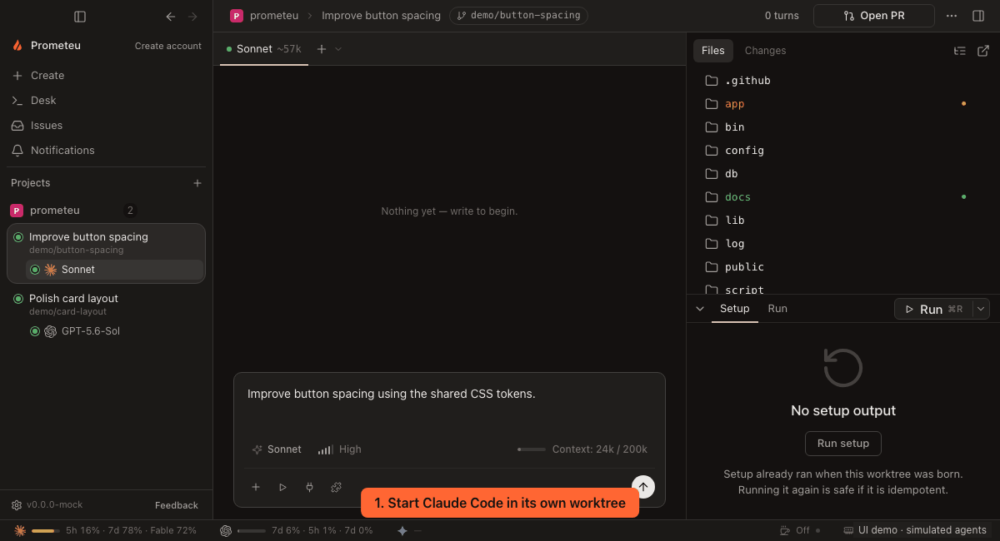

<p align="center"> <strong>Prometeu</strong><br>
Run Claude Code, Codex, Cursor CLI and Antigravity agents in parallel — each in its own git worktree, with built-in diff review.</p>

<p align="center">
  <a href="https://github.com/prometeucorp/prometeu/releases/latest"></a>
  <a href="LICENSE"></a>
  <a href="https://github.com/prometeucorp/prometeu/releases"></a>
  <a href="#install"></a>
</p>

<p align="center"></p>

<p align="center">
  <strong><a href="https://github.com/prometeucorp/prometeu/releases/latest/download/Prometeu_aarch64.dmg">Download for macOS (.dmg)</a> ·
  <a href="https://github.com/prometeucorp/prometeu/releases/latest/download/Prometeu_x86_64.AppImage">Linux (.AppImage)</a></strong><br>
  macOS Apple Silicon · Linux x86_64<br>
  ⭐ <a href="https://github.com/prometeucorp/prometeu">Star the repo if it saves you time</a>
</p>

## Why not just use the CLI?

- Run agents in parallel. It is not necessary to move between many terminals.
- Prometeu makes an isolated worktree for each task. Thus, two agents do not
  edit the same checkout.
- Examine the changes in a visual review before you commit and merge them.
- Use Claude Code, Codex, Cursor CLI and Antigravity in one app on macOS and
  Linux.
- Prometeu is free and open source under the MIT license. Each provider uses
  your own account. Your provider sends you the bill for the use of its models.

## Features

- **Cursor CLI:** login through the external CLI, interactive approvals and
  account quotas. See [the Cursor procedure](#cursor-cli).
- **Parallel workspaces:** isolated worktrees, many repositories and a desk that
  shows conversations side by side. Delegated work goes into one level of
  sub-workspaces. Each sub-workspace has one conversation and the icon of its
  provider.
- **Visual Git review:** unified diffs or side-by-side diffs, review notes, staging,
  commits, history and the repair of merge conflicts.
- **Built-in tools:** an editor, a terminal, a browser preview, MCP servers,
  plugins, skills and actions that you can use again.
- **Terminal sessions:** shells in the sidebar that do not have a project or a
  workspace. A shell starts in your home folder or in a folder that you select.
  The shells stay after the app starts again (macOS and Linux).
- **Tasks:** filter Linear and GitHub issues and pull requests, then start a
  workspace. The PR status and the notifications show the work that is
  necessary next.
- **Stored conversations:** resume agents that stopped. Examine the local
  history of tokens and costs.
- **Remote supervision:** connect a remote workspace to a generic signed webhook
  through Prometeu Cloud. External supervisors get updates about execution and
  GitHub when the desktop app is not open. See
  [the procedure and the receiver contract](docs/contracts/supervision.md).
- **Usage (macOS and Linux):** filter the local consumption by period and by
  workspace. Examine the composition of tokens and the data of each session in
  Settings / Analytics. Prometeu shows the costs that the provider reports. It
  also shows clearly which measurements are missing.
- **Optional collaboration:** share encrypted conversations and continue them
  from companion devices. The execution stays on the Mac of the owner.
- **English and Portuguese UI**, with dictation on macOS.

The [provider matrix](docs/quality/provider-matrix.md) gives the differences
between agents, the limits of each platform and the test coverage. The demo
above uses the interface of the app with simulated agent data. It is not a benchmark
of a live provider.

## Install

### macOS — Apple Silicon

Download [Prometeu_aarch64.dmg](https://github.com/prometeucorp/prometeu/releases/latest/download/Prometeu_aarch64.dmg),
open it and drag Prometeu to Applications. You can install updates from the app.

### Linux — x86_64

Download [Prometeu_x86_64.AppImage](https://github.com/prometeucorp/prometeu/releases/latest/download/Prometeu_x86_64.AppImage)
to a folder that your user can write to. Then run these commands:

```sh
chmod +x Prometeu_x86_64.AppImage
./Prometeu_x86_64.AppImage
```

The AppImage adds a launcher to the menu of your applications. You can install
updates from the app. The [Linux guide](docs/operations/linux.md) gives the
runtime requirements, the source packages, the ARM64 builds and the differences
between platforms.

### Windows — discontinued

Prometeu does not operate on Windows at this time.
[v0.45.0](https://github.com/prometeucorp/prometeu/releases/tag/v0.45.0) is the
last Windows release. Its installer is available on that page, but Windows
installations do not get updates. By default, the current history stays in
`~/.local/share/prometeu-windows/state` in WSL. The macOS and Linux builds do not
import that history.

### Cursor CLI

Prometeu can use Cursor CLI on macOS and Linux since v0.35.0. Do these steps:

1. Install a Cursor CLI that can use ACP.
2. Make `cursor-agent` available in your shell.
3. Sign in with `agent login`.
4. Attach its account in Settings.
5. Select the account in the launcher.

Prometeu can use streaming, tools, resume, stop, questions, plan approvals and
the hub MCP with Cursor. The account quotas use the current CLI login. The hub
plugins, the skills and the meters of tokens and cost for each turn are not
available. See the [Cursor contract](docs/contracts/cursor.md).

## Quick start

1. **Connect an agent.** Install Claude Code, Codex, Cursor CLI or Antigravity
   CLI (agy 1.2.7 or newer) and log in.
2. Make `claude`, `codex`, `cursor-agent` or `agy` available in your shell.
   Cursor and Antigravity use the login of their CLI.
3. **Add your project.** Open Prometeu and add a local Git repository or folder.
   For local work, a Prometeu account is not necessary.
4. **Run your first task.** Make a workspace and select a model.
5. Keep the new-worktree option enabled to isolate the changes, and send a task.
6. For a parallel task, open a different workspace.
7. Before you commit, examine the changes in the Git view.

By default, agents use tools without an approval for each tool. They have the
file and process access of your local user. Worktrees keep the changes
isolated, but they are not sandboxes. A folder without Git opens at its
location. Use only projects and tools that you trust.

### Native conversations — macOS development builds

Select **Settings → General → New conversations → Terminal**. New
conversations then open in the installed Claude Code, Codex, Cursor or
Antigravity TUI. Current tabs keep their saved mode.

Each local conversation shows one interface. In Terminal mode, it shows the
native terminal. In Chat mode, it shows the chat of Prometeu. Prometeu continues
to record the history for status, notifications and shared sessions. Run slash commands
and change permission modes in the native terminal. Claude and Codex also
accept individual answers to approvals and questions through Prometeu. Cursor
and Antigravity decisions stay in their native terminals, also for shared
conversations.

The terminal fills the area of the conversation. No controls float above its
output. Change the model and the effort in the native CLI. The menu at the right
of the central tab bar shows these controls of Prometeu:

- actions
- MCP
- plugins
- skills
- dictation
- remote access

The context menu of the tab and the header menu of the desk panel give the same
actions. In Chat and in Terminal, that same row of the tab bar also has these
controls: the PR, the workspace menu and the side panel. Context that Prometeu
did not send has its own indicator in that group of actions or in the header of
the desk. Prometeu continues to show the collaboration notices that you must
answer.

Select, drop or paste files to put their paths directly into the native prompt.
This operation does not send the prompt. The browser context and the review
notes stay available in the tools dialog for **Insert into terminal**. Edit and
send the message in the input of the provider.

Checks on the macOS Tauri app show that native responses, canonical history and
cold resume operate correctly for all four providers. The
[provider matrix](docs/quality/provider-matrix.md) records the limits of each
provider and the checks that are not complete. Linux keeps only Chat mode.

## Privacy

**Usage analytics are off by default, and you must enable them. This rule applies
since v0.34.0, also after an upgrade.**
You can change **Settings → General → Privacy → Share usage data** when you want.
When you enable this setting, macOS and Linux builds send feature events to
PostHog with a random installation ID. These events do not contain content.
They do not contain prompts, transcripts, file paths, project names or agent
output. See the [analytics contract](docs/contracts/product-analytics.md).

The local usage history stays on your computer. You can export or delete it.
The app state and the transcripts that the app manages are in `~/.prometeu`.
Claude Code owns its Chat-mode transcripts. Native terminal conversations also
keep the canonical history of Prometeu. The model provider that you select gets
the content that is necessary to run your tasks, under the terms of that
provider.

Cloud accounts and shared conversations are optional. Shared conversations use end-to-end
encryption. The relay sees the routing metadata. The keys use trust on first
contact and use changed keys automatically. There is no forward secrecy.
See [the limits of the encryption](docs/decisions/0022-end-to-end-encryption.md) and
[the local data storage](docs/contracts/persistence.md). Report a
vulnerability privately as [SECURITY.md](SECURITY.md) tells you.

## Contributing

Start with the [good first issues](https://github.com/prometeucorp/prometeu/issues?q=is%3Aissue%20is%3Aopen%20label%3A%22good%20first%20issue%22)
and [CONTRIBUTING.md](CONTRIBUTING.md).
The [development guide](docs/operations/development.md) tells you how to prepare
the local environment and run the checks.

[Documentation](docs/README.md) · [Architecture](ARCHITECTURE.md) ·
[Report a bug](https://github.com/prometeucorp/prometeu/issues/new/choose) ·
[Changelog](CHANGELOG.md)

<a href="https://www.greptile.com/?utm_source=oss_badge&utm_medium=readme&utm_campaign=greptile_for_open_source"></a>

## License

[MIT](LICENSE).
