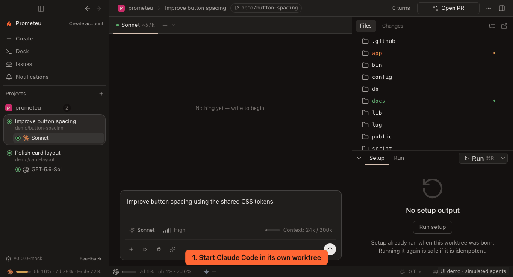

<p align="center"> <strong>Prometeu</strong><br>
Run Claude Code, Codex, Cursor CLI and Antigravity agents in parallel — each in its own git worktree, with built-in diff review.</p>

<p align="center">
  <a href="https://github.com/prometeucorp/prometeu/releases/latest"></a>
  <a href="LICENSE"></a>
  <a href="https://github.com/prometeucorp/prometeu/releases"></a>
  <a href="#install"></a>
</p>

<p align="center"></p>

<p align="center">
  <strong><a href="https://github.com/prometeucorp/prometeu/releases/latest/download/Prometeu_aarch64.dmg">Download for macOS (.dmg)</a> ·
  <a href="https://github.com/prometeucorp/prometeu/releases/latest/download/Prometeu_x86_64.AppImage">Linux (.AppImage)</a> ·
  <a href="https://github.com/prometeucorp/prometeu/releases/latest/download/Prometeu_x64-setup.exe">Windows (.exe)</a></strong><br>
  macOS Apple Silicon · Linux x86_64 · Windows x64: experimental, Codex through WSL<br>
  ⭐ <a href="https://github.com/prometeucorp/prometeu">Star the repo if it saves you time</a>
</p>

## Why not just use the CLI?

- Run parallel agents without juggling terminals.
- Create isolated worktrees automatically for separate tasks, so agents do not edit the same checkout.
- Review changes visually before committing and merging.
- Use Claude Code, Codex, Cursor CLI and Antigravity in one app on macOS and Linux.
- Free and open source under the MIT license. Bring your own provider account; model usage is billed by your provider.

## Switching from Conductor?

Prometeu reads `.conductor/settings.toml`, including setup, run and archive scripts,
so your existing project setup carries over. `CONDUCTOR_` environment variables
remain available. If both settings files exist, `.prometeu/settings.toml` takes
precedence without merging. See [project scripts](docs/operations/project-scripts.md).

## Features

- **Cursor CLI:** external CLI login, interactive approvals and account quotas. See [Cursor setup](#cursor-cli).
- **Parallel workspaces:** isolated worktrees, multiple repositories and a desk for conversations side by side.
- **Visual Git review:** unified or split diffs, review notes, staging, commits, history and conflict resolution.
- **Built-in tools:** editor, terminal, browser preview, MCP servers, plugins, skills and reusable actions.
- **Issue workflow:** Linear and GitHub issues, PR status and notifications.
- **Persistent conversations:** resume stopped agents and inspect local token and cost history.
- **Optional collaboration:** share encrypted conversations and continue from companion devices while execution stays on the owner's Mac.
- **English and Portuguese UI**, with dictation on macOS.

See the [provider matrix](docs/quality/provider-matrix.md) for agent differences,
platform limits and test coverage. The demo above uses the real interface with
simulated agent and Git data; it is not a live provider benchmark.

## Install

### macOS — Apple Silicon

Download [Prometeu_aarch64.dmg](https://github.com/prometeucorp/prometeu/releases/latest/download/Prometeu_aarch64.dmg),
open it and drag Prometeu to Applications. In-app updates are available.

### Linux — x86_64

Download [Prometeu_x86_64.AppImage](https://github.com/prometeucorp/prometeu/releases/latest/download/Prometeu_x86_64.AppImage)
to a directory writable by your user, then run:

```sh
chmod +x Prometeu_x86_64.AppImage
./Prometeu_x86_64.AppImage
```

The AppImage adds a launcher to your application menu and supports in-app updates.
See the [Linux guide](docs/operations/linux.md) for runtime requirements, source
packages, ARM64 builds and platform differences.

### Windows — x64, experimental

Install WSL with a default Linux distribution, Git and an authenticated Codex CLI
inside that distribution. Download and run
[Prometeu_x64-setup.exe](https://github.com/prometeucorp/prometeu/releases/latest/download/Prometeu_x64-setup.exe),
then open Prometeu from the Start menu.

Windows currently supports **Codex only**. The installer is unsigned; updates
require installing the next version manually. Managed login and Cloud
synchronization are unavailable. Conversations and files stay in WSL after
updating or uninstalling. See [Windows coverage](docs/contracts/windows-application.md).

### Cursor CLI

Cursor CLI is implemented on macOS and Linux. Install a CLI with ACP support,
make `cursor-agent` available in your shell, sign in with `agent login`, attach
its account in Settings and select it in the launcher. Streaming, tools, resume,
stop, questions and plan approvals are supported. Account quotas use the existing CLI login; hub tool
selections and per-turn token/cost meters are unavailable. See the
[Cursor contract](docs/contracts/cursor.md).

## Quick start

1. **Connect an agent.** Install and authenticate Claude Code, Codex, Cursor CLI or Antigravity CLI (agy 1.2.7 or newer). Make `claude`, `codex`, `cursor-agent` or `agy` available in your shell. Cursor and Antigravity use their CLI login; Windows uses Codex in WSL.
2. **Add your project.** Open Prometeu and add a local Git repository or folder. No Prometeu account is required for local work.
3. **Run your first task.** Create a workspace, choose a model, keep the new-worktree option enabled for isolation, and send a task. Open another workspace for a parallel task, then review changes in the Git view before committing.

Agents execute tools without per-tool approval by default, with your local user's
file and process access. Worktrees separate changes; they are not sandboxes.
Folders without Git open in place. Use projects and tools you trust.

## Privacy

**Usage analytics are opt-in and off by default since v0.34.0, including upgrades.**
Change **Settings → General → Privacy → Share usage data** at any time.
Opted-in macOS and Linux builds send content-free feature events to PostHog with
a random installation ID. Prompts, transcripts, file paths, project names and
agent output are excluded. See the [analytics contract](docs/contracts/product-analytics.md).

Local usage history stays on your computer and can be exported or deleted.
App state and app-managed transcripts live under `~/.prometeu`; Claude Code
owns its transcripts. Your chosen model provider receives the content needed to
run your tasks, under that provider's terms.

Cloud accounts and sharing are optional. Shared conversations use end-to-end
encryption; the relay sees routing metadata. Keys use trust on first contact
with automatic adoption of changed keys, and there is no forward secrecy.
See [security limits](docs/decisions/0022-end-to-end-encryption.md) and
[local data storage](docs/contracts/persistence.md). Report vulnerabilities
privately through [SECURITY.md](SECURITY.md).

## Contributing

Start with [good first issues](https://github.com/prometeucorp/prometeu/issues?q=is%3Aissue%20is%3Aopen%20label%3A%22good%20first%20issue%22)
and [CONTRIBUTING.md](CONTRIBUTING.md).
For local setup and checks, see the [development guide](docs/operations/development.md).

[Documentation](docs/README.md) · [Architecture](ARCHITECTURE.md) ·
[Report a bug](https://github.com/prometeucorp/prometeu/issues/new/choose) ·
[Changelog](CHANGELOG.md)

<a href="https://www.greptile.com/?utm_source=oss_badge&utm_medium=readme&utm_campaign=greptile_for_open_source"></a>

## License

[MIT](LICENSE).
