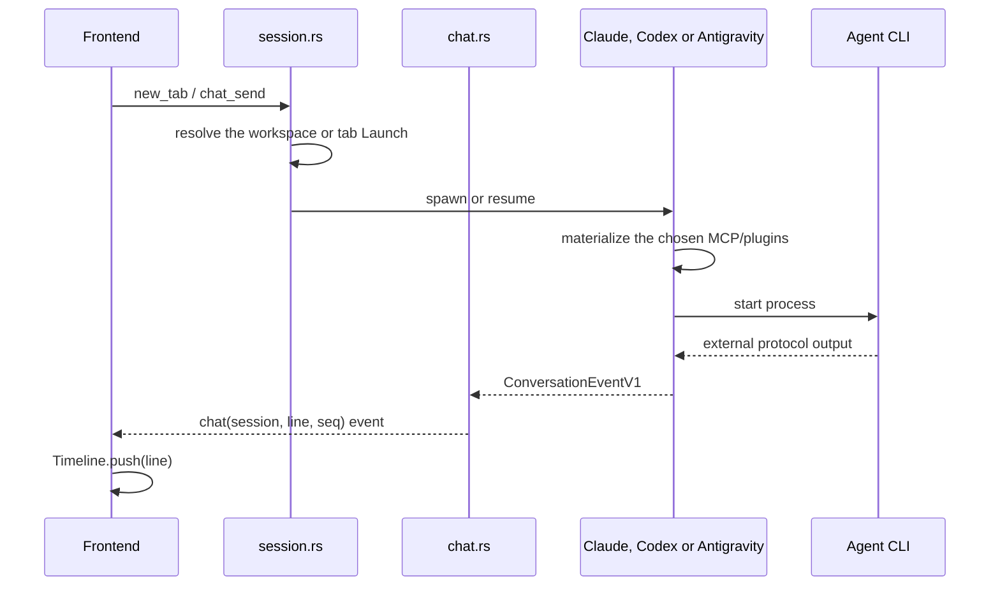

# Conversation flow

This page gives the current architecture.

## Core concept

A tab is a logical session. The identity and the transcript continue to be
available after the process of the agent stops. If a person closes or archives
the tab, or if the process stops, the conversation stays. The next message can
resume it.

## Start and resume

The `Launch` of the core contains the agent, the model, the effort, the plan
mode, MCP, the plugins and the skills. `LaunchService` prepares, starts and
installs the conversation through effects that the caller supplies. `agent_launch.rs` supplies
the native preparation for each provider. `ConversationWorkers` use the output
when the pipe drains operate. The
[application-core contract](../contracts/application-core.md#sessions-launch-and-workers)
gives the order and failure rules.

A tab can override the agent, the model and the effort of the workspace. Usual
tabs get their tools from the global, trusted project and workspace layers for
the provider that the tab uses. [Tasks](../contracts/actions.md) keep a resolved copy
of the profile, with the tools, the instructions and the permissions.

The adapters prepare the tools at the edge:

- Claude gets MCP and the plugins through its own files and flags.
- Codex gets the MCP table through an override. It gets the plugins through a
  derived marketplace in a configuration `CODEX_HOME`. Each workspace has an
  isolated copy of that folder.
- Cursor gets the hub MCP through ACP `mcpServers` on `session/new` and
  `session/load`.

The account comes from the global selection of the provider. The process
captures it when it starts. The sessions and the plugin cache stay shared. The
configuration layer keeps the workspace and the account different. It does not
write the selection into the global `config.toml`.

If Prometeu cannot prepare an explicit selection, the conversation does not open
without it. This also applies if Prometeu cannot activate the declared hooks of
a plugin before `SessionStart`. The conversation does not open without a
warning. The full marketplace flow is in
[`plugin-marketplace.md`](../contracts/plugin-marketplace.md).

A change of account does not stop the current turn. The next message resumes the
process with the selected account. Prometeu queues the messages that it gets
during the change. The plugin history and the configuration stay available. The
contract is in [`accounts.md`](../contracts/accounts.md).

A change of model in the same CLI stops the process and keeps the session. A
change from Claude to Codex, or from Codex to Claude, must use a different tab.
Their resume procedures do not share an identity.

The changes to MCP, plugins and skills of a workspace go through
`workspace_tools.rs`. It validates the selection and changes only the requested
axis of the workspace. It keeps each tab and each current process. A person can
save during a turn. The changes apply at the next start or resume of a stopped
process. They do not apply at the next message to an idle process. `session.rs`
keeps the native argument processing, the error translation and the board
publication. The tests of the validation and of the state updates operate
without a Tauri application.

## Agent output

### Claude

`claude.rs` starts `claude -p`. It changes `ConversationCommandV1` into its
`stream-json` input. It normalizes each output line into `ConversationEventV1`.
The process also writes the native transcript of Claude Code. The compatibility
reader changes that transcript during replay.

### Antigravity

`antigravity.rs` changes the native agy NDJSON directly to V1. It keeps the
conversation ID for an explicit resume and uses the current external account.
There is no ACP handshake or replay barrier. The presentation replays only its
V1 log. Interactive approvals and plan transitions are not available. SIGINT
goes to the process group. If the process stops, the native conversation
resume follows.

### Codex

`codex.rs` starts `codex app-server` and uses JSON-RPC to send messages to it and get messages from it.
It changes each response, request or notification directly into
`ConversationEventV1`. In the other direction, it gets `ConversationCommandV1`
and builds the related JSON-RPC request. It does not use the stream-json format
of Claude. Prometeu writes the V1 events in its own transcript.

### Cursor

`cursor.rs` prepares `cursor-agent acp`. `prometeu-protocols::cursor` changes
the JSON-RPC updates and the client requests directly to V1. The start uses the
selected external account, the accurate ACP model ID and the workspace
directory. During load, the adapter does not use the native replay, because the
presentation replays the V1 log of the application. Approvals, questions and
plan decisions use the current request cards. Refer to the
[Cursor contract](../contracts/cursor.md).

### Common path

`Pump.feed` sends the JSON parsing and the observation order to the
`SessionOutput` of the core, which records through `Lines`. The stream
removes private telemetry, keeps the line and gives it a transport sequence. It
does this through transcript and event ports that the host supplies. The host holds the same
mutex during the recording, the `chat` delivery and the snapshots. Refer to the
[stream contract](../contracts/application-core.md#conversation-stream-and-pump).

When the host sends a command, it holds this mutex during two operations. They
are the write to the child and the recording of the local user and echo events. Thus, after a
satisfactory send, the host records those events before a fast response from the
child can get the mutex. If the write has a failure, the host records no user event.
Thus, the person can send the pending message again.

Independent stdout and stderr readers continue to drain into channels while
command writes hold the publication locks. Thus, pipe backpressure does not
cause a deadlock of the child. The queued lines drain before the exit cleanup.
Long stalls can increase the queue memory. `prometeu-process` owns the drains
and the reaping. EOF alone does not mark a live child as stopped at any time.

The state reactions run after the host releases the conversation locks. Only the
in-memory projection of the delegation execution operates differently. It
records the canonical order under the buffer lock and publishes after that.
Refer to [embedded MCP](../contracts/embedded-mcp.md) for the lock order. Refer
to [ADR 0023](../decisions/0023-ordered-publication.md) and to the concurrency
tests in `src-tauri/crates/core/src/conversation/stream/tests.rs`.
`src-tauri/src/chat.rs` keeps the integration tests for files and native pipes.

The `Timeline` reducer changes V1 events into user items, assistant messages,
tool blocks, requests, results, context and warnings. It is pure. It does not
touch the DOM, Tauri, the disk, the network or provider protocols. Legacy lines
go through `conversation-legacy.ts` before the reducer. Its `busy` value is for
the main turn. `working` adds the background tasks. The conversation screen
uses `working` for the Stop button and the busy composer. Thus, the person can
continue to stop child tasks that continue after the turn.

`ConversationView` selects one local screen from the saved mode of the tab.
Chat tabs use the structured chat. Terminal tabs use
`TerminalConversationView`, without a second transcript view or a screen
selector. A shared `ChatView` controller continues to use the canonical events.
It does not render its feed or its editable message field. The native terminal
fills the conversation area. It has no permanent footer and no floating
controls on its output.

These menus open the shared product controls when the person wants them:

- The workspace menu at the right of the central tab bar.
- The context menus of the tabs.
- The menus in the desk headers.

MCP, plugins, skills, actions, context, dictation and remote access keep their
current owners. Quotation and manual resume use those menus when they are
available. If the owner must answer a collaboration notice, the notice stays in
view adjacent to the terminal. The tools dialog does not hide it.

Model and effort changes use the native CLI. Prometeu keeps the launch defaults
and does not show duplicate selectors in the conversation. The backend owns
the canonical ingestion and the persistence, independently of the local screen.
The execution status stays in the indicators of the tab and of the sidebar. The
native screen does not show that status again in a header. In Chat and in
Terminal, the PR, workspace-menu and side-panel controls are at the right end
of the central tab-bar row. The pending context has its own indicator in that
action group or in the desk header. It does not change the status of the agent
at any time.

The native terminal typography and its neutral palette are presentation
defaults. The
[terminal state contract](../contracts/terminal-state.md#terminal-query-ownership)
keeps the colors of the renderer the same as the helper query replies and the
replay.

The pending-context indicator in the action group of the tab bar, or the
indicator in the desk header, shows queued local messages. The tools dialog
gives a **Queued message** control and a read-only preview of the full prompt.
It does not add a footer, and it does not show a queued send as a warning. The
indicator goes away with the pending prompt. Pending messages from teammates
keep the approval controls of the owner in view. If the owner edits one, the
text goes into the stage, and Prometeu does not send it.

When a person selects, drops or pastes files into a native conversation,
Prometeu puts their paths directly into the native prompt without Enter.
Browser context, review notes and text previews stay in the tools dialog until
the person clicks **Insert into terminal**. The composer of the CLI is the only
local message input that a person can edit.

The two paths capture the tab, the attachment and the process generation
before the asynchronous work. They do not resume a process or send the content
to a different tab at any time. If a paste has a failure, the initial tab keeps its
remaining draft, and the person can try again. Images use individual bracketed
pastes with literal paths, in quotes when necessary, without `@`. Documents keep
their path mentions.

After each satisfactory file write, Prometeu removes that file before it goes to
the next file. Thus, if one file has a failure, Prometeu does not put the satisfactory files
in again. A satisfactory insertion removes only the captured context. It keeps
additions that occur at the same time. A file drop that comes late continues to belong
to its initial tab. Prometeu marks review notes as sent only when the
canonical user content agrees with the captured review envelope. A paste alone
does not send a review. This acknowledgment uses the current lifetime of the
in-memory draft.

Quotations from the native screen contain text without an invented transcript
anchor. When a person opens a comment anchor on a local terminal tab, the focus
goes to the native terminal. No other feed comes into view. Remote members use
the canonical conversation through `ChatView`. The PTY stays on the machine of
the owner, and the native bytes do not become relay messages.

`Term` owns each xterm instance. On disposal, it releases these items:

- Its event subscriptions.
- The input and selection listeners.
- The composition listeners.
- The resize observer.
- The recovery callback.

OSC 8 HTTP(S) hyperlinks show their destination when the pointer is on them.
They use the current `open_external` command to open the system browser. This
shared handler also applies to the other terminals. The default popup of xterm
does not start the native browser.

When mouse reporting is enabled, a primary press on a hyperlink stops at the
screen of xterm. The linkifier of xterm sees the press first. Mouse reporting
does not send it to the PTY. If Shift is pressed, the press makes a terminal
selection. Thus, CLIs that use the mouse do not open the same link a second
time. Mouse input out of links continues to go to the CLI. Prometeu does not
find plain text URLs without OSC 8 markup.

When the view attaches, it waits for the listeners before it fetches a
snapshot. It buffers live events and filters them by process generation and
sequence. Replayed terminal queries cannot send answers to the child. The input
stays disabled until the parser callback of xterm shows that the snapshot
parsing is complete. Input and serialized resizes contain the generation. Thus,
a previous attachment cannot change a process that started again.

The `agent-terminal-started` invalidation at publication time refreshes a
terminal in one condition. An account handoff replaced a ready process, and the
status of the tab did not change. The current snapshot stays the authority for
the generation.

When a person opens a local terminal tab, Prometeu automatically resumes its
saved native session if the snapshot has no running process. This also applies
after the app starts again. Surfaces that open at the same time share one
resume request. The backend starts one launch at a time for each session. Then
the view gets a new snapshot without sending text. Navigation and disposal cancel
the attachment. A resume that has a failure or stops immediately does not
start again in a loop. The manual resume control is for a retry when the
automatic attachment ends without a running process. It is not necessary to
open the tab.

The native snapshot uses the restorable screen of the packaged headless
emulator. This screen includes the normal and alternate buffers, the cursor, the
modes and the input state that is not complete. The raw tail does not replace a
satisfactory screen restoration. After a helper failure, Prometeu does not use that process.
Refer to the [terminal state contract](../contracts/terminal-state.md) for the
state that it can restore and for the limits.

Tests: `src/term.test.ts`, `src/terminal-conversation.test.ts`,
`src/conversation-view.test.ts`, `src/native-conversation-draft.test.ts`, and
the native-screen case in `e2e/composer.spec.ts`. That case examines the xterm
geometry and the keyboard focus in a browser. macOS shows the default in
Settings / General. The [provider matrix](../quality/provider-matrix.md) makes a
difference between this implementation and browser evidence, and the
conformance of the native Tauri app.

`ChatView` continues to process each live line in order. It paints the visible
changes one time in each animation frame. An update of text only paints its
current message again. It does not build the composer or the comment pins
again. The working and compaction transitions refresh the composer. Piece
additions and replacements refresh the pins.

When the native window is hidden or in the Dock, live lines continue to update
the timeline, but the transcript paint waits. A visible window without focus
continues to paint. For example, a window on a second monitor or in split view
paints, so the person can follow the response. When a context event shows the
window again, the view paints the changed pieces from the buffer one time. Or,
it renders a snapshot that came while the window was hidden. If the native
context is not available, the rendering stays active. Stable piece keys
continue to keep the selection, the expanded cards and the comment anchors.

Native subagents continue after the turn that started them. Thus, a
conversation stops only when the turn is complete *and* `background.changed` shows no
task. `SessionReactions` keeps the tab in `Rodando` until then. It also keeps
the queued input in the queue. The delegation execution stays `running`, with
its result recorded before. An interruption stops all of them at the same time,
because it also stops the child tasks. Refer to
[ADR 0056](../decisions/0056-background-tasks-hold-completion.md).

When the app stops or starts again for an update, it does not stop a turn in an
orderly manner. The app stops, and the agent stops with it. If a local
conversation is working or waiting, Prometeu shows a confirmation first for these
actions:

- ⌘Q.
- A close of the main window.
- **Restart to update**.

Prometeu cannot stop the Quit command of the Dock, a logout or a shutdown
([ADR 0097](../decisions/0097-ask-before-ending-the-app.md)).

At the next start, `Board::revive` marks the tabs that were working or waiting
as `interrupted`. Prometeu shows a conversation without a process with a
snapshot that has `session.state: stopped` at the end. The timeline keeps a
turn that is not complete as stopped. It does not show it as complete:

- The partial reply has no completion footer.
- Open requests show as closed without an answer.
- An `interrupted` notice marks the position.

The composer of an interrupted tab gives **Continue**, which is a usual message.
When the core reactions accept a message, they clear the marker. The transcript
has no record of the interruption, and the native history of Claude cannot
contain one. Thus, the board keeps the position. When the conversation starts
again, `chat.rs` records the line count of its history in `Tab.cuts`. Each
subsequent snapshot replays `stopped` at that position.

A question or an approval keeps the tab in `Querendo` from `request.opened`
until the person answers. The answer makes `request.closed`, which immediately
moves the tab back to `Rodando`. This does not occur if a different request of
the same conversation stays open. Output that streams during that time does not
hide the wait.

`Work` keeps the open requests. It removes them when the conversation stops,
because a turn that is complete cannot get the answer. Thus, a late answer does not
start a stopped tab again. The `SessionReactions` of the desktop get the status
from the `next_status` rule in `prometeu-core`. Thus, the sidebar, the desk, the
island and the `conversation_status` of the delegation MCP agree.

`alert.ts` follows the executions of each tab from the live local `chat` events.
It keeps them different from the unread state. `chat.rs` publishes
`session.state` `starting` when the process starts. It publishes `busy` after it
accepts `message.send`, before the local message and the echoes, under the same
publication lock. Only that `busy` starts to monitor an execution.
Assistant activity shows that the execution started. Snapshots, history,
echoes and answers to requests do not start to monitor an execution.

A `turn.completed` with success or error, and without background tasks, can
become a notice after 1 second. New activity cancels the candidate. No activity
alone does not mean completion. An interruption stops the execution without a
pending item. A terminal event without activity, for example `/context`, also
makes no pending item. If it has an error, it makes a pending item.

If a terminal event comes while tasks operate, Prometeu holds it until the
tasks drain. Then it becomes a candidate. A drain alone completes nothing. A
terminal event from the main agent is always necessary. If the main agent
answers again, Prometeu discards the held event. When the person looks at the
conversation, the candidate stops, as with all other completions. Claude
normalizes tasks itself. Codex changes `collabAgentToolCall.agentsStates`,
`subAgentActivity` and known child events into the same event. It keeps the
content of the child tasks isolated.

The completion stops the notice also when the conversation is in view. If the
person looks at the conversation or answers, the execution does not start
again. A conversation is in view when the window has the focus and one of these
conditions applies:

- The tab is open in the workspace.
- The frame on the desk is not collapsed.

`request.opened` updates the Dock. It can also send an optional notification one
time for each open request. The Dock counts workspaces. It adds the pending items
to the `unread` value of the backend and to the inbox comments. Optional local
notifications use the same rule through a composition callback in `main.ts`.
Comments stay silent. The V1, transcript and relay formats do not change.

The 1-second window uses the signals of the CLI. It cannot find a
subsequent continuation that the CLI did not announce. The
[notification contract](../contracts/notifications.md) and
[ADR 0054](../decisions/0054-local-notifications.md) give the preferences and
the native delivery.

## Input and control

A local message goes through `chat_send` and the core `SessionService`. The
`SessionHost<Chat>` of the desktop composes this service. If the process is
ready, the service sends the message immediately. If not, the message stays in
`pending_prompt`, and the service resumes the process. The message goes into the
buffer before the events that it causes. `SessionPump` schedules the pending
input after the checks for the end of the turn and for the setup.

Interruptions and answers to questions or permissions use
`ConversationCommandV1` and go through `chat_control`. Remote control uses
`chat_control_remote`. This command builds the answer again from the request
that is in the buffer. Thus, a remote client cannot replace the command or the
input that the owner saw.

## Snapshot and sharing

`chat_snapshot` returns `{ text, seq }` under the same lock that gives numbers
to the live output. The peer renders the snapshot up to `seq`. It discards the
live events that have a sequence that the snapshot includes.

The frontend of the owner sends the conversation to the relay only while a
person looks at it. The relay does not run commands in the worktree. It sends
messages and controls to the app of the owner. The app validates them and
writes to the local process.

## Collaboration comments

Comments are a collaboration layer on the conversation. They are not
`ConversationEventV1` events. `notes.ts` shows the threads in the side panel.
`team.ts` keeps the roots, the replies, the state and the inbox the same as the
relay. The primary box continues to send only commands to the agent.

When there is context, the root stores the tab id and the `Piece.key` that the
reducer made. `chat.ts` uses that key to render the marker and to find the excerpt
again. It does not put the comment into the transcript. The quote keeps
context that a person can read, if the excerpt is not available. When a person
opens an assignment, the application only goes to it. When a person resolves
the root, the thread closes for all persons.

## State ownership

| State | Owner | Note |
| --- | --- | --- |
| workspaces, tabs and agent selection | `crates/core/src/board.rs` | Stored in `board.json` |
| in-memory process | `prometeu-process`, composed by `chat.rs` | Supplied control and the waiter that owns it. Prometeu can discard it. |
| replay buffer and snapshots | `crates/core/src/conversation/stream.rs` | Supplied storage and events. The host supplies the order mutex. |
| Codex JSON-RPC thread | `codex.rs` + `Tab.agent_session` | Necessary for resume |
| drawn items | `timeline.ts` | Derived from the transcript |
| conversation DOM | `chat.ts` | Presentation |
| transport sequence | `crates/core/src/conversation/stream.rs` | It is not the stored identity of the event |
| presence and audience | relay | Collaboration state |
| comments, resolution and inbox | relay | Stored overlay, different from the transcript |

## Compatibility

[`ADR 0002`](../decisions/0002-canonical-conversation-protocol.md) specifies the
contract in force in
[`conversation-events-v1.md`](../contracts/conversation-events-v1.md).
Prometeu does not write current transcripts again. The reader accepts legacy
transcripts and ignores historical V1 mirror projections. New Codex logs contain
only V1 events. They do not make legacy mirrors. Refer to the current
[conversation contract](../contracts/conversation-events-v1.md).
